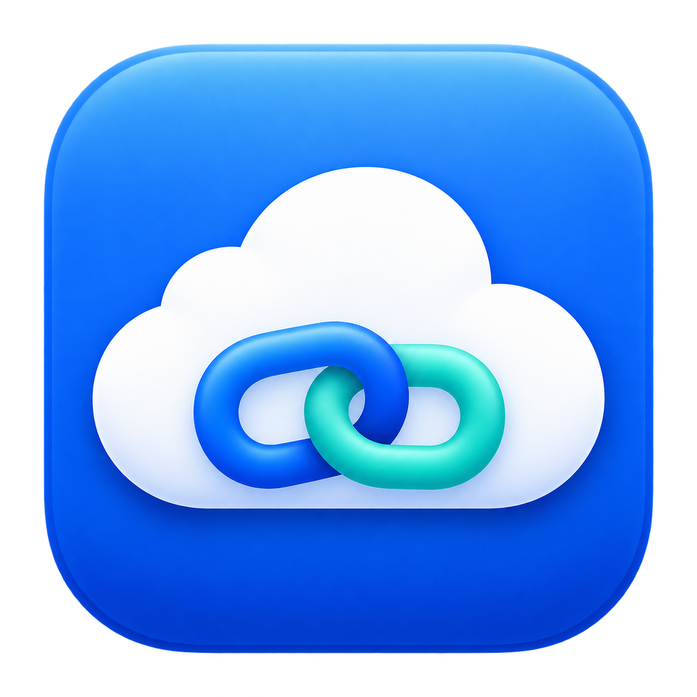

# 云连接助手



macOS 原生 AppKit 窗口，用现有系统代理连接 Codex 云服务，并提供本机官方 Antigravity 的代理启动与授权网络检查入口。使用 AppleScriptObjC 和 Python 标准库，没有新增第三方 Python 依赖。

## 下载 macOS App

[下载 v1.1.1 Apple Silicon 版](https://github.com/xinxinzai98/cloud-link-assistant/releases/download/v1.1.1/cloud-link-assistant-v1.1.1-macos-arm64.zip) · [发布页与校验文件](https://github.com/xinxinzai98/cloud-link-assistant/releases/tag/v1.1.1)

适用于 M 系列芯片 Mac。Releases 版内置 Python，无需另外安装 Homebrew 或 Python。解压 ZIP，将 App 拖入“应用程序”，开启已有系统代理后打开。Intel Mac 暂未提供经过验证的安装包。

升级已有版本时：

1. 已开启自启的用户，先在旧版菜单选择“关闭开机自动启动…”，退出窗口后替换原 App，再在新版菜单重新开启。这样会同时更新系统中的守护程序副本，仅替换 App 不会更新正在运行的系统副本。操作期间云连接会短暂重连，恢复记录保留。
2. 未开启自启的用户，先停止旧中继并退出窗口，再替换原 App、从新版启动。

保持原 App 路径和文件名，并保留旧状态目录及其恢复备份，直到停止和恢复设置都已确认完成。为兼容已登记的登录项，App 文件名保留“云连接助手 1.0.app”；实际版本号在“关于”窗口显示为 1.1.1。

App 使用临时签名，未完成 Apple 公证。若 macOS 提示无法验证开发者，请核对下载来源与校验值，再按 [Apple 的说明](https://support.apple.com/guide/mac-help/open-a-mac-app-from-an-unknown-developer-mh40616/mac)在“系统设置 → 隐私与安全性”中确认打开这个 App。

## 功能与系统改动

- 启动、停止、查询中继状态，异常后恢复自有设置。
- 仅监听 `127.0.0.1:443`，为 `codex-cloud-backend.chatgpt.com` 临时添加带标记的 hosts 映射。
- GUI 启动时只为 `Wi-Fi` 追加这一个域名的系统代理例外；停止时撤销自有项，保留其他配置。
- 开启自启守护后，运行中约每 10 秒核对本工具添加的域名例外，丢失时补回；保留当前其他例外，不接管用户原有的同域名例外。
- 通过回环地址的系统 HTTP 代理发送 CONNECT，透传 TLS 字节，保留客户端的 SNI 和证书校验。
- 通过代理查询加密 DNS，避免 hosts 映射导致上游连接绕回本机。
- 管理进程维护设置和恢复备份，网络转发进程以原普通用户运行。
- 打开 Antigravity；未运行时附带进程级代理参数，已运行时只显示现有窗口。

启动和恢复设置需要 macOS 管理员授权。关闭窗口保留后台；退出时可选择保留后台或停止中继。默认不设置开机启动，可按下文另行安装原生启动项。

## 环境

- macOS，内置 `osacompile`、`codesign` 和 AppKit；本机使用 Python 3.14 验证，构建脚本要求 Python 3.11+。
- 已开启系统 HTTPS 代理，地址为 `127.0.0.1`、`localhost` 或 `::1`，代理支持 HTTP CONNECT。
- `127.0.0.1:443` 未被其他服务占用；GUI 当前按 `Wi-Fi` 网络服务处理代理例外。
- 使用 Antigravity 入口时，官方应用应安装在 `/Applications/Antigravity.app`。

上述 Python 与编译工具用于源码构建。默认源码构建复用指定的本机 Python；Releases 安装包随 App 打包可搬移的 Python 运行环境。

## 构建

```sh
python3 build.py
```

产物为 `dist/云连接助手 1.0.app` 和 `dist/云连接助手 1.0.zip`。已有产物不会被覆盖，可用 `--output` 指向新目录。构建只编译与签名，不启动 App 或中继。

```sh
python3 build.py --python /absolute/path/to/python3 --output /absolute/path/to/new-output
```

制作可直接下载使用的安装包时，传入完整的可搬移 Python 目录。程序会把解释器、标准库和上游许可证一起复制进 App；运行时按 App 所在位置寻找内部解释器。

```sh
python3 build.py --bundle-python /absolute/path/to/standalone/python --output /absolute/path/to/new-output
```

随包运行环境来源、版本和 SHA-256 见 [THIRD_PARTY_NOTICES.md](THIRD_PARTY_NOTICES.md)。打包采用 `ditto`，保留运行环境的符号链接和可执行权限。

App 使用 `assets/appicon.icns`，包含 16–1024 像素图标；原始 PNG 和 imagegen 提示词也保存在 `assets/`。构建时撤除脚本模板的图标目录引用，并验证签名。

默认不探测其他目录中的旧中继。需要接管既有中继时，在保留原状态目录及其恢复备份的前提下构建：

```sh
python3 build.py --legacy-state /absolute/path/to/existing/.state
```

路径只嵌入本机构建产物，源码不包含个人目录。新启动的状态目录为：

```text
~/Library/Application Support/云连接助手/relay-state
```

## 使用

1. 开启现有代理客户端的系统代理，无需 TUN。
2. 打开构建出的 App，查看状态后按需启动，并在系统窗口输入管理员密码。
3. 停止中继后，程序撤销自有 hosts 映射和代理例外。
4. 若显示“需要恢复设置”，保留状态目录和备份，使用“恢复设置”。

Antigravity 的 Google 登录、账号选择和授权在官方应用及浏览器完成。助手不读取或保存登录令牌。匿名 TLS 检查通过只代表网络连通，不代表登录成功、账号地区符合条件或模型可用。地区申请及账号受理也由 Google 处理。

## 开机自动启动（可选）

首次使用先在 App 中成功启动一次中继，再在“云连接助手”菜单选择“开启开机自动启动…”或“关闭开机自动启动…”，由系统窗口完成管理员验证。下载版已包含原生菜单和安装组件。也可使用仓库中的 `autostart.py` 和两个 `.command` 文件。双击 [开启开机自动启动.command](开启开机自动启动.command)，或传入 App 路径：

```sh
zsh ./开启开机自动启动.command "$HOME/Applications/云连接助手 1.0.app"
```

首次需要输入一次管理员密码。安装使用 macOS 原生 LaunchDaemon 和用户 LaunchAgent：开机后等待指定用户登录、现有系统代理就绪，再启动同一个云中继；登录时打开助手窗口。代理或网络暂不可用时每 15 秒重试，不回退直连，也不启动或修改代理客户端。

系统执行的 Python、脚本和状态位于 root 所有且普通用户不可写的 `/Library/Application Support/CloudLinkAssistant`。原状态目录和全部恢复记录会整体迁移，原路径保留链接，现有 App 的启动、停止和恢复按钮继续使用同一份状态。安装时现有中继会短暂重连；转发进程仍以原普通用户运行。

手动停止后本次开机保持停止，下次重新开机再自动启动。启动进程异常退出时由系统重试；关闭助手窗口会保留后台。开机启动不保证代理额度、节点或外部网络持续可用。

v1.1.1 修复了运行中域名例外被改写后不会自动恢复的问题。已开启自启时，手动“启动”也会调用同一个系统守护服务；手动停止后不继续补回例外。未开启自启时仍沿用原手动启动方式，不会擅自安装启动项。

关闭自动启动可使用 App 菜单或 [关闭开机自动启动.command](关闭开机自动启动.command)。它卸载两个启动项并停止中继，撤销自有网络设置；系统副本和全部恢复记录保留，App 仍可手动启停，也可再次开启自动启动。

## Codex 本地聊天与云端兼容

本地聊天遇到 `Broken pipe` 或反复重连时，可使用仓库中的 [通过系统代理启动Codex.command](通过系统代理启动Codex.command)。它读取当前回环地址上的系统 HTTPS 代理，为新启动的 Codex 客户端传入进程级代理环境。

使用前，确认用户级 `~/.codex/config.toml` 的默认 `model_provider` 为官方 `"openai"`（也可不写该项）。当前排查的桌面版本会在全局默认提供商改为自定义 HTTP/SSE 提供商时隐藏云端入口，即使自定义提供商仍使用官方接口。脚本不自动修改配置文件。

1. 开启系统代理，需要云聊天时同时保持云连接助手中继运行。
2. 等正在运行的任务完成，按 `⌘Q` 完整退出 Codex 主客户端。
3. 双击启动脚本，再分别检查本地连续回复、原云聊天读取及新建聊天的云端入口。

脚本当前查找 `/Applications/ChatGPT.app`；如果客户端安装在其他位置，先调整脚本中的 `app_target`。仅做配置检查可运行：

```sh
zsh ./通过系统代理启动Codex.command --check
```

脚本保留现有直连范围，并合并系统代理例外，使 `codex-cloud-backend.chatgpt.com` 继续进入单域名中继。它不强制退出客户端、不改 hosts 或系统代理、不设置全局 `launchctl` 环境。代理变量只在本次启动中传入，之后直接从 Dock 启动不保证沿用这些变量。该脚本目前随源码提供，已发布的 v1.0.0 App ZIP 不包含此新增入口。

2026-10-23 的受控测试中，官方默认提供商加显式代理环境完成了 5 次真实回复，其中一次在空闲 45 秒后继续；未显式传入代理的对照测试出现重连。客户端重启后已核对本地后台带有代理环境，原云聊天读取成功，短时客户端日志未发现同类 `Broken pipe`。这些结果不代表已验证长期使用、休眠唤醒或所有网络条件下都稳定，新建云端入口仍需在界面中确认。

## 验证

```sh
PYTHONDONTWRITEBYTECODE=1 python3 -m unittest discover -s . -p 'test_*.py' -q
```

现有 35 项测试覆盖 hosts 恢复及并发修改保留、代理例外、DNS 地址校验、TLS 透传和证书校验、隔离进程生命周期、Antigravity 启动参数，以及自动启动的等待、手动停止、异常重试、状态迁移回退、反复开关、域名例外恢复与停止时的竞争条件。测试使用临时目录与本地随机端口；不修改真实 hosts、Wi-Fi 设置或账号，也不启动真实 Antigravity。

构建通过与隔离测试通过不等于真实管理员首启、长期云连接或 Antigravity 登录验收通过。现有用户环境下仍可能因代理和网络中断而重连。

## 源码

- `main.applescript`：原生窗口、状态与启停入口；解释器和可选旧状态路径由构建时填入。
- `relay.py`：固定域名的 CONNECT 中继与设置恢复。
- `antigravity_helper.py`：官方应用入口、进程代理及匿名 TLS 检查。
- `通过系统代理启动Codex.command`：以现有系统代理启动 Codex 的可选入口，保留系统代理例外。
- `build.py`：编译、临时签名和打包。
- `autostart.py`：系统启动项安装、代理等待及可恢复关闭；两个开关 `.command` 文件为入口。
- `THIRD_PARTY_NOTICES.md`：随包 Python 的来源与许可证位置。
- `test_relay.py`、`test_antigravity.py`、`test_autostart.py`：隔离测试。

Git 只保存源码与说明。运行日志、hosts 备份、账号信息、OAuth 回调、地区申请材料、截图和 App 产物不纳入仓库。
